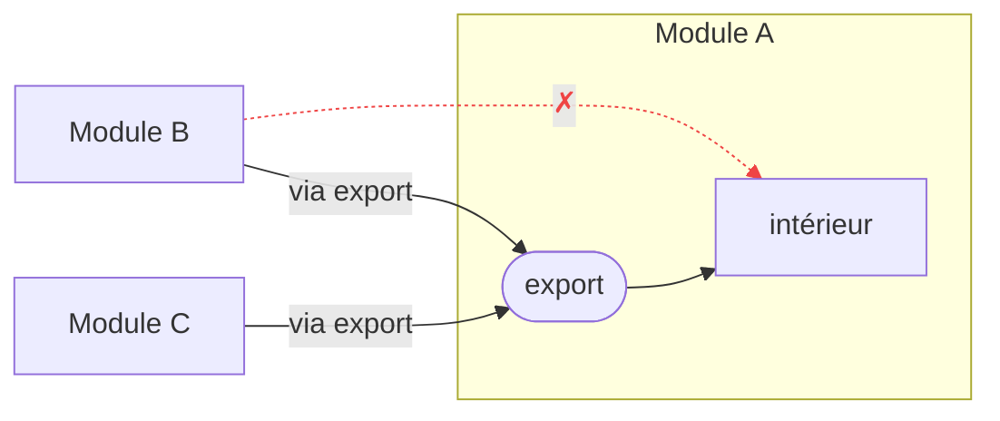

# Les modules avant les couches

Quand c'est l'IA qui écrit le code, le goulot devient la revue. Les contraintes d'archi, l'IA les comprend très bien. Ce qui compte, c'est de pouvoir lire un diff et de savoir en 2-3 secondes : ça touche tel module et tel autre, **rien d'autre ne peut être affecté**. Le périmètre à relire et à tester se réduit d'autant.

Ce qui permet ça, ce n'est ni la Clean Architecture ni l'hexagonal. Les deux découpent à l'horizontale, en couches, à l'intérieur d'une application. Ce qui compte, ce sont les frontières verticales entre modules.

## Un découpage possible

Une règle unique : **l'extérieur connaît l'intérieur, l'intérieur ne connaît jamais l'extérieur.**

Entre modules, on ne touche jamais les entrailles d'un autre : seulement son `export/`, appelé depuis son propre adapter et converti dans son propre modèle. Les modules eux-mêmes s'ordonnent du plus central au plus périphérique, et les dépendances ne vont que vers le centre.

À l'intérieur d'un module hexagonal, c'est la même règle à une autre échelle : le `domain` est l'intérieur, `controllers/` et `data-access/` l'extérieur.

Le tout vérifié par un test d'architecture, pas par la bonne volonté.

## Ce qui compte, ce qui ne compte pas

Le monolithe modulaire strict va plus loin : chaque module possède ses tables, aucun `JOIN` entre modules. En pratique, c'est pénible. On isole le **code**, pas les données : le schéma reste un, avec ses FK et ses `JOIN`.

Et un petit module n'a pas besoin d'être hexagonal. Il peut rester à plat, sans `domain/` ni ports. Aucun problème, tant que sa frontière n'est pas poreuse.

Une couche mal rangée à l'intérieur d'un module, c'est un dégât local, corrigé en une après-midi. Une frontière poreuse, c'est un couplage qui se propage partout, et un diff qu'on ne peut plus relire sans tout relire.
